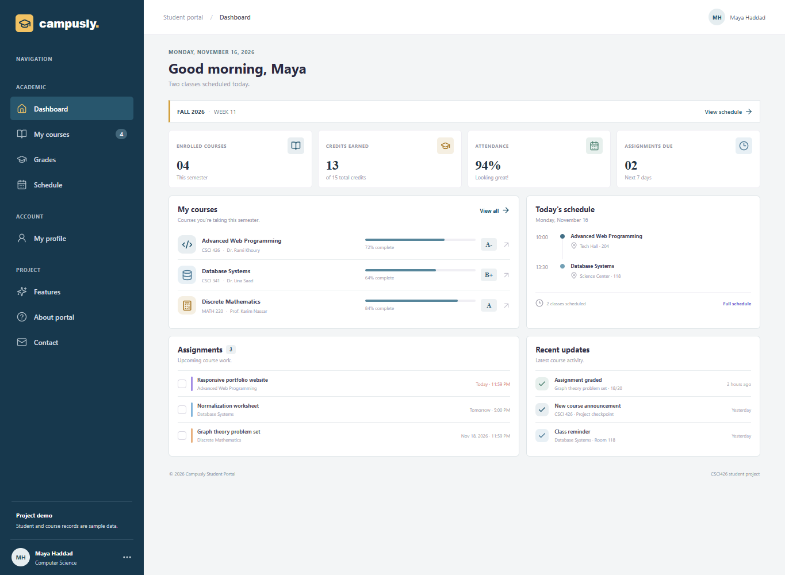
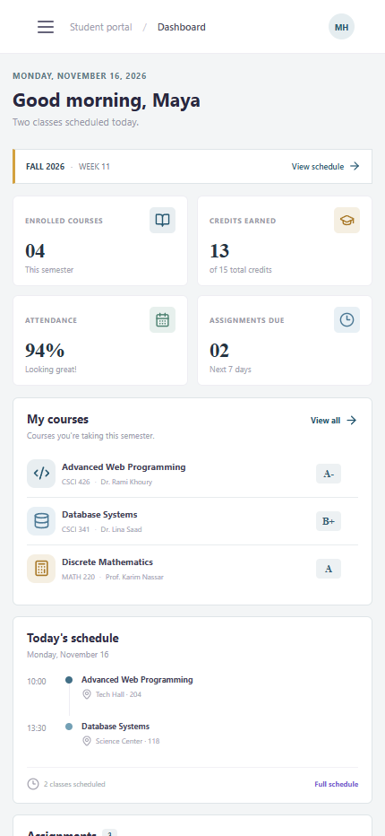

# Campusly Student Portal

Campusly is a responsive student portal prototype for the CSCI426 Advanced Web Programming project. It brings student profile details, current courses, grades, a weekly schedule, and assignment reminders into one interface.

The portal is a frontend demonstration. Its student, course, and grade information is fictional and stored locally in JavaScript. It does not connect to a university database or authenticate real students.

## Pages

- **Dashboard** - semester overview, course progress, upcoming classes, assignment checklist, and recent activity.
- **My courses** - active course cards with instructor, credits, meeting details, progress, and grades.
- **Grades** - course scores and semester GPA summary.
- **Schedule** - responsive weekly calendar.
- **My profile** - sample student identity and academic snapshot.
- **About, Features, and Contact** - project information, feature overview, and a client-side contact form demonstration.

## Technologies

- React and React Router
- Vite
- Plain CSS with responsive breakpoints
- Lucide icons

## Run locally

1. Install Node.js (version 20 or newer recommended).
2. Clone this repository and open its folder.
3. Install dependencies with `npm install`.
4. Start the development server with `npm run dev`.
5. Open the local URL printed by Vite.

Create a production build with `npm run build`. Preview it locally with `npm run preview`.

## Screenshots

### Desktop dashboard

### Mobile dashboard

These screenshots use fictional sample data.

## Deployment

The app can be deployed as a static Vite site to Vercel or Netlify by connecting the GitHub repository and using `npm run build` as the build command with `dist` as the output folder. GitHub Pages can also be used after setting Vite's `base` to the repository path.

Deployment still needs a student-owned GitHub repository and hosting account. No public deployment URL is included in this project copy.

## Version control

Review the repository commit history with `git log --oneline`. Add your own milestones as you develop and customize the project, for example: initial layout, responsive pages, and documentation. The repository's initial setup commit is included when this project is delivered.

## Student customization before submission

- Replace the fictional profile, course, instructor, dates, and grade details with your own chosen demo data.
- Add screenshots captured from the final running version.
- Fill in the group contribution statement with the actual names and work completed by each student.
- Create the GitHub repository, deploy the site, and add the repository and live links to the report.
- Confirm your instructor's rules for permitted AI assistance and disclose assistance if required.
