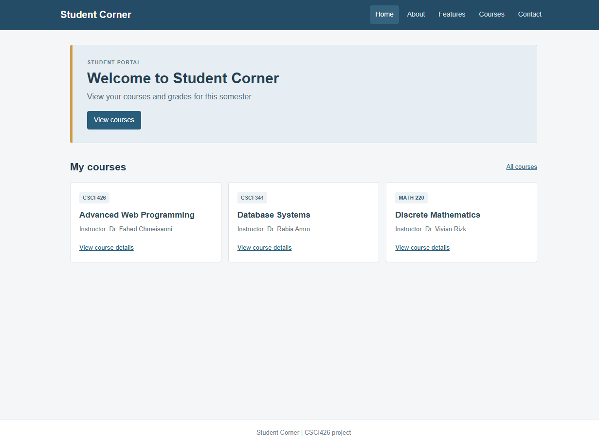
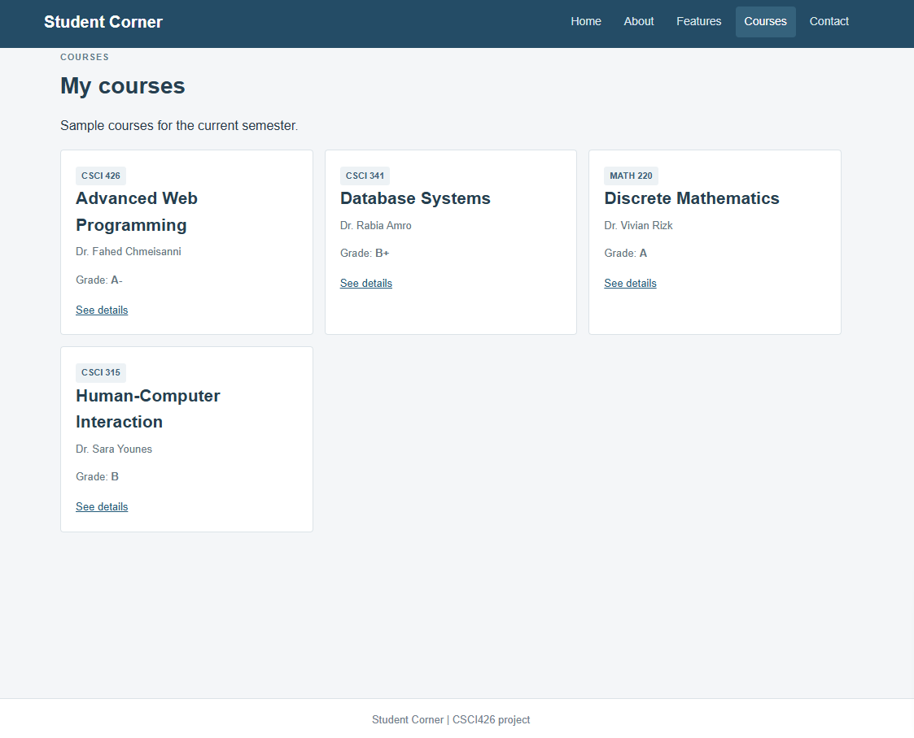
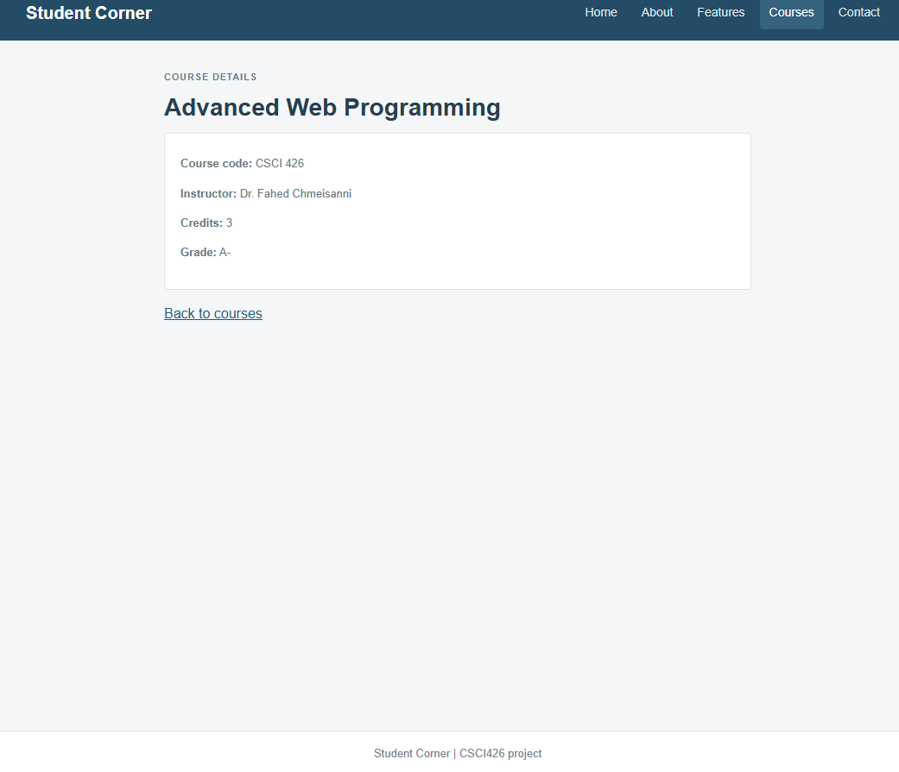
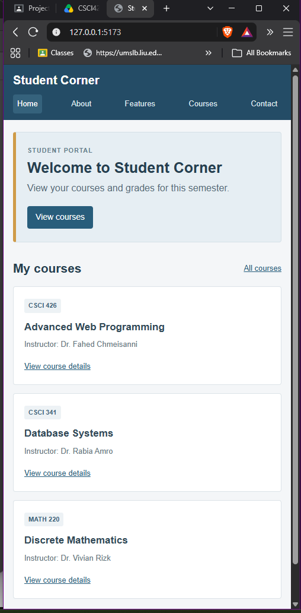

# Student Corner

Student Corner is a small React website for a university project. It lets students view example course information and a basic student profile.

## Pages

- Home
- About
- Features
- Courses
- Course details (dynamic page)
- Contact

All student and course information is fictional sample data. The contact form only displays a confirmation in the browser; it does not send email.

## Technologies

- React
- React Router
- Vite
- CSS

## Run the project

1. Install Node.js.
2. Open this folder in a terminal.
3. Run `npm install`.
4. Run `npm run dev` and open the local address shown in the terminal.

To create a deployable version, run `npm run build`. The output is saved in `dist` and can be hosted on Vercel or Netlify.

## Screenshots

### Home page

### Course list

### Course details

### Home page at a narrow width

